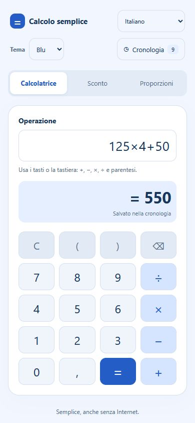
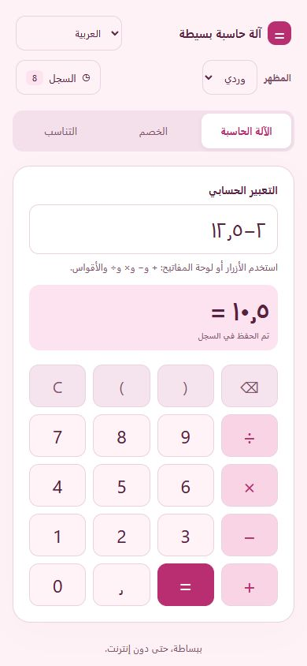

# Calcolo semplice

**Italiano** · [English](README.en.md)

Una piccola app Android per fare calcoli quotidiani, trovare uno sconto e risolvere proporzioni con passaggi guidati. Funziona offline, senza account, pubblicità o servizi di analisi.

**Versione 0.4.0** · **Android 8.0 o successivo** · **40 lingue** · **Temi blu e rosa**

## Cosa puoi fare

- **Calcolatrice:** somma, sottrazione, moltiplicazione e divisione, con parentesi, numeri negativi e decimali.
- **Sconto percentuale:** inserisci l'importo in euro e la percentuale di sconto. L'app mostra quanto risparmi e il totale da pagare.
- **Proporzione guidata:** inserisci tre quantità direttamente proporzionali e ottieni la quarta, con il calcolo spiegato.
- **Formula matematica:** usa `A : B = C : D`, scegli la posizione di `x` e inserisci gli altri tre numeri.
- **Cronologia:** ritrova e riapri gli ultimi 200 calcoli; puoi cancellarli con conferma.
- **Personalizzazione:** scegli il tema blu o rosa e la lingua. Le preferenze restano salvate sul dispositivo.

Esempi: **80 € − 25% = 60 €**, con un risparmio di 20 €; **2 : 150 = 6 : x → x = 450**.

## Anteprima

<p>
  
  
</p>

Schermate dell'interfaccia eseguita nel browser. Non sono fotografie di una prova su telefono Android.

## Lingue

L'interfaccia comprende **40 lingue**, con nomi nativi in ordine alfabetico secondo la collazione italiana. Arabo, ebraico, persiano e urdu hanno un'interfaccia da destra a sinistra; le formule mantengono l'ordine matematico da sinistra a destra.

Sono supportati anche diversi sistemi di cifre e separatori decimali locali. Tutte le traduzioni sono incluse nell'app e funzionano offline. Consulta l'[elenco completo delle lingue](docs/languages.md).

Le traduzioni non hanno ancora ricevuto una revisione professionale madrelingua. Correzioni e miglioramenti sono benvenuti.

## Aprire il progetto in Android Studio

1. Scarica il repository con **Code → Download ZIP** oppure clonalo:

   ```sh
   git clone https://github.com/devfaxpro/calcolo-semplice.git
   ```

2. Apri la cartella contenente `settings.gradle` in Android Studio.
3. Seleziona **JDK 21** per Gradle e installa **Android SDK Platform 36** e **Build-Tools 36.0.0** dall'SDK Manager.
4. Attendi la sincronizzazione, collega un dispositivo o avvia un emulatore, quindi premi **Run**.

La prima compilazione richiede Internet per scaricare Gradle e gli strumenti necessari. L'app compilata funziona offline. È necessario un Android System WebView aggiornato.

### Generare un APK di prova

Windows, dalla cartella del progetto:

```powershell
.\gradlew.bat :app:assembleDebug
```

macOS / Linux:

```sh
chmod +x gradlew
./gradlew :app:assembleDebug
```

L'APK si trova in `app/build/outputs/apk/debug/app-debug.apk`.

Il repository non contiene chiavi di firma. Gradle usa una chiave di sviluppo locale: un APK compilato su un altro computer può avere una firma diversa dalle build già installate. Per aggiornare la stessa app mantenendo i dati occorre usare lo stesso certificato. Le build debug sono per le prove; una distribuzione di produzione richiede la propria firma.

Su Windows è disponibile anche `build-apk.ps1`, che usa direttamente gli strumenti SDK già installati:

```powershell
.\build-apk.ps1 -Sdk 'C:/percorso/Android/Sdk' -Jdk 'C:/percorso/jdk-21'
```

Output: `build/manual/Calcolo-semplice-0.4.0-debug.apk`. Questo script genera una chiave di prova separata nella cartella locale `.dev-signing/`, esclusa da Git.

## Test e limiti

Con Node.js 22 o successivo, dalla cartella del progetto:

```sh
node --test tests/math.test.cjs
```

La suite contiene 13 test: operazioni, sconti, proporzioni, input non validi, oltre mille casi matematici generati, completezza delle traduzioni e formati numerici delle 40 lingue. La versione 0.4.0 è stata compilata e l'interfaccia è stata controllata nel browser. La prova su un telefono Android reale resta da fare.

Il motore usa frazioni esatte. La calcolatrice mostra fino a 10 decimali, le proporzioni fino a 6; quando utile viene mostrata la frazione esatta. Le espressioni accettano fino a 120 caratteri e ogni numero fino a 24 cifre intere e 12 decimali. Gli sconti sono arrotondati al centesimo.

## Dati e privacy

Cronologia, tema e lingua sono salvati solo nella memoria locale dell'app. Non sono richiesti account o permessi Internet e non sono inclusi tracker o annunci. Disinstallare l'app o cancellarne i dati elimina anche cronologia e preferenze. I dati dell'anteprima nel browser sono separati da quelli dell'app Android.

## Struttura del progetto

| Percorso | Contenuto |
| --- | --- |
| `app/src/main/assets/` | Interfaccia HTML/CSS/JavaScript e motore matematico |
| `app/src/main/assets/strings.js` | Catalogo e traduzioni delle 40 lingue |
| `app/src/main/java/` | Activity Java e WebView con contenuti locali |
| `app/src/main/res/` | Nomi localizzati dell'app, icona e tema Android |
| `tests/math.test.cjs` | Test automatici |

Configurazione: Gradle **8.13**, Android Gradle Plugin **8.13.2**, JDK **21**, `minSdk 26`, `compileSdk/targetSdk 36`, `versionCode 5`, package `it.calcolosemplice.app`.

## Contributi e licenza

Per segnalare un problema indica la versione Android, la lingua, i passaggi per riprodurlo e il risultato atteso. Per una traduzione indica la lingua e il testo da correggere. Prima di proporre modifiche esegui i test e non aggiungere chiavi, credenziali o file generati.

Non è stata ancora scelta una licenza per il codice dell'app. Il Gradle Wrapper mantiene gli avvisi di licenza presenti nei suoi file.
